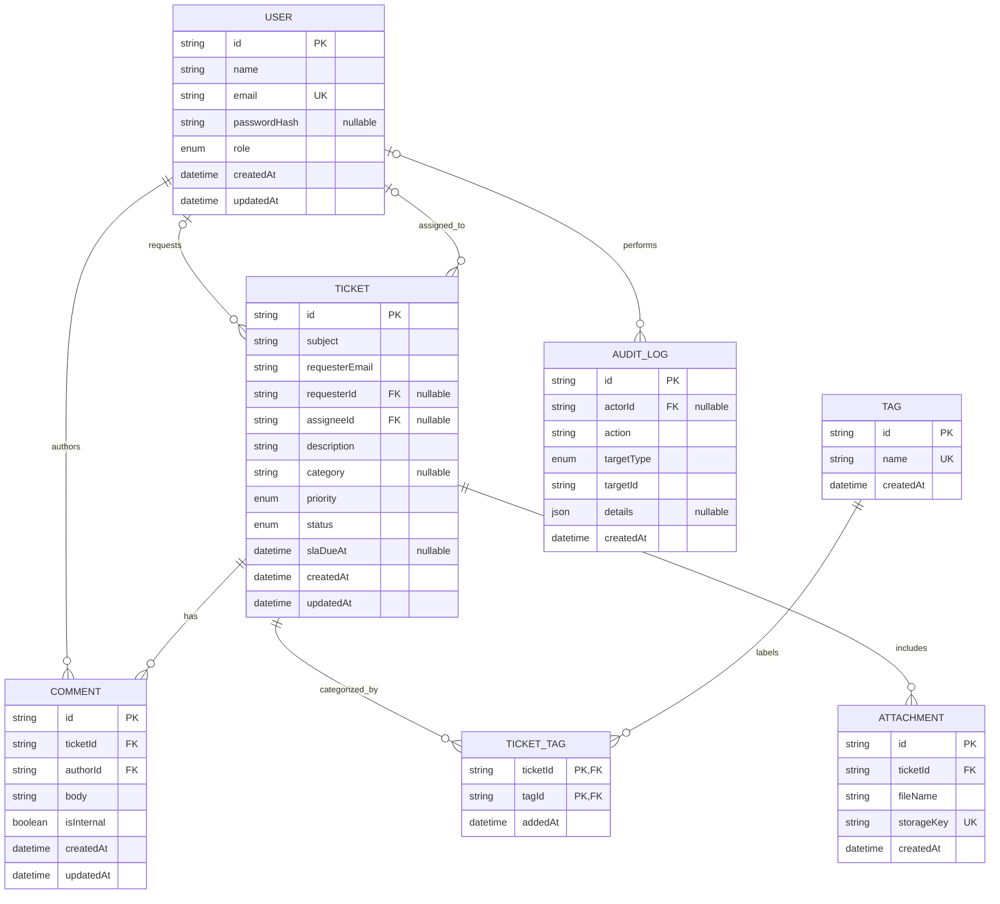

# SupportDesk Entity Relationship Diagram

This diagram matches the current Prisma schema. The nullable ticket requester/assignee links preserve legacy imported tickets; see [database design notes](./database-design-notes.md) for assumptions and deletion behavior.

`AUDIT_LOG.targetId` is intentionally not a foreign key because the target may be a ticket, user, comment, tag, or attachment; audit records should also remain after a target is removed.
